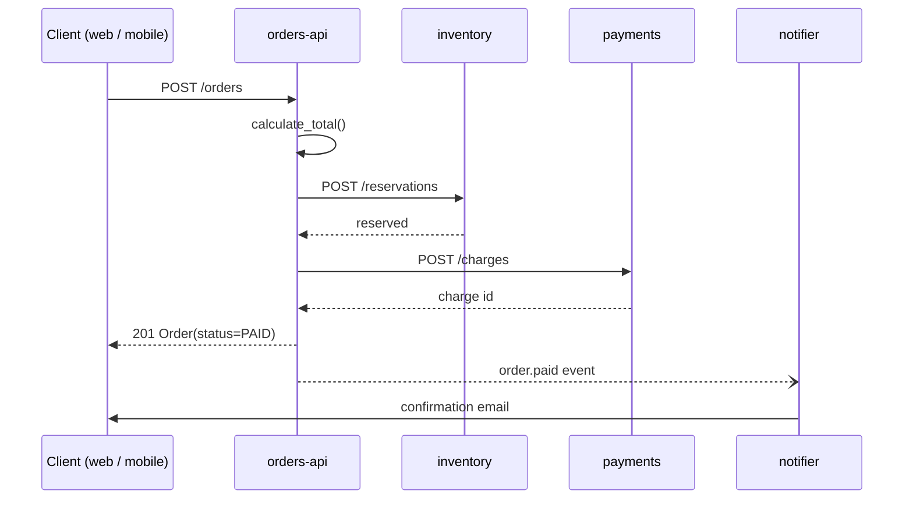

# Architecture

The web and mobile clients talk only to `orders-api`. It prices the order,
reserves stock with `inventory`, charges the card through `payments`, and
publishes an event that `notifier` turns into an email.

## Order lifecycle

`PENDING` → `RESERVED` → `PAID` → `SHIPPED`, or `CANCELLED` from any state
before `SHIPPED`. A failed charge releases the reservation and cancels.

See [ADR 0001](adr/0001-monorepo.md) for why this is one repository.
